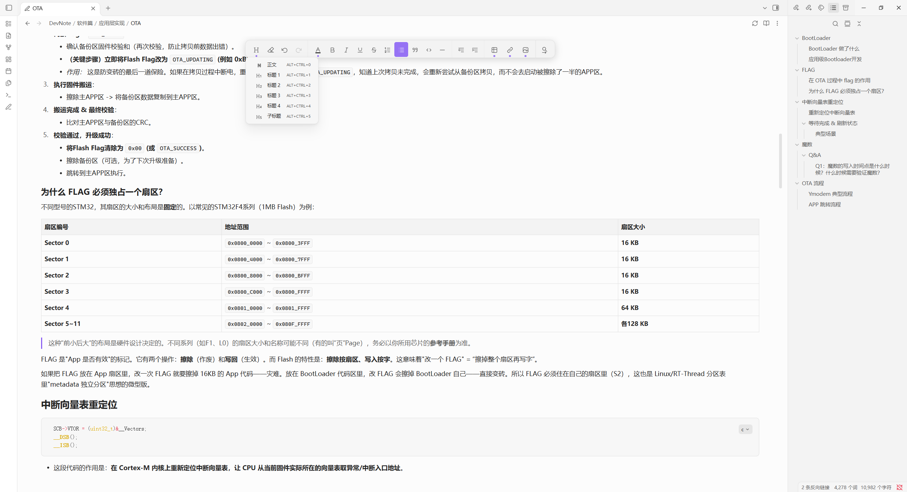
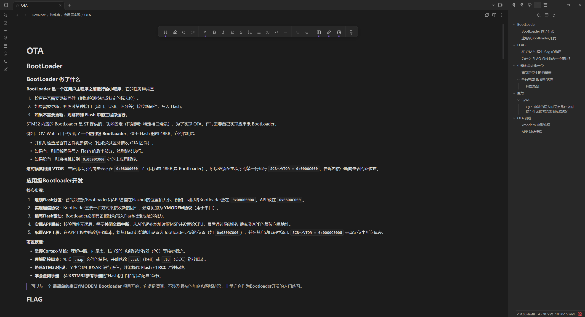
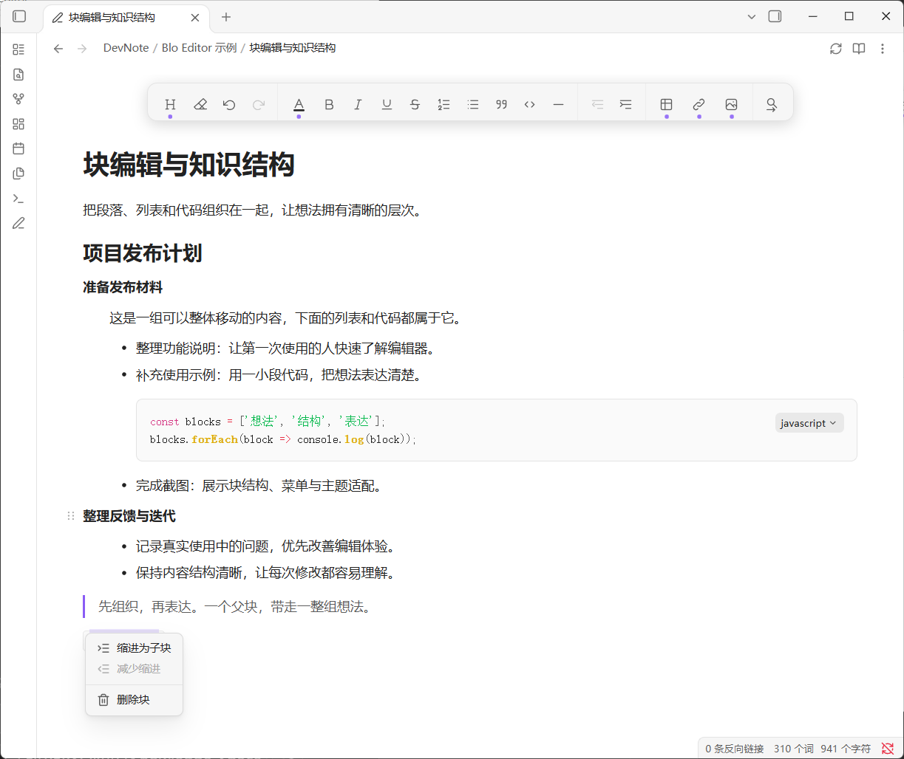
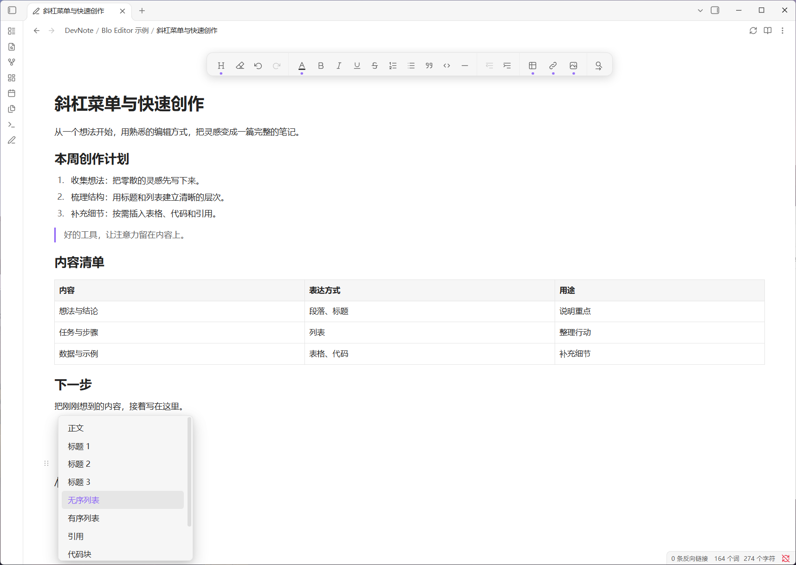

# Blo Editor

<p align="center">
  
</p>

A Yuque-inspired block editor for Obsidian, built on Wysimark Editor and Slate.
Blo comes from block. Maintained by **OrlandoHsu29**.
Based on [Wysimark Editor](https://github.com/takeshy/obsidian-wysimark) 1.3.2
by Takeshi Morita. Upstream copyright and the MIT license are retained.
See [UPSTREAM.json](UPSTREAM.json) and [the original README](https://github.com/takeshy/obsidian-wysimark#readme).

[中文说明](README.zh-CN.md)

## Screenshots

### Light theme

Floating toolbar, paragraph styles, tables, code highlighting, and the native outline.



### Dark theme

Rich-text block editing with headings, nested lists, inline code, and quotes.



### Block structure

Organize paragraphs, lists, and code into parent and child blocks.



### Slash commands

Type `/` to open the command menu and insert content without leaving the editor.



## Installation

1. Extract the release ZIP and copy `blo-editor` into your vault's `.obsidian/plugins/`.
2. Restart Obsidian and enable **Blo Editor** under Community plugins.
3. Open a Markdown note. Disable other rich-text editor plugins to avoid competing default views.

Requires desktop Obsidian 1.8.7 or later. Release packages contain no personal
settings, notes, attachments, dependencies, or migration tools.

## Features

- Rich-text formatting with theme-aware colors and Markdown storage.
- Parent/child block dragging and indentation; click a block handle to select
  the block and open its menu. Tab and Shift+Tab adjust indentation.
  Delete a block and its children from the menu; undo restores the group.
- Lists, quotes, tables with header row/column controls, and code highlighting.
- Find and replace, slash commands, native outline navigation, and reading mode.
- Automatic saving and save-before-close; Ctrl+S saves immediately.

Headings 1–4 appear in the outline. Subheadings use H5 styling with extra spacing
and stay out of the outline. Headings can be combined with ordered lists.
The default editor can cover the whole vault or a folder configured in settings.

Common shortcuts: Ctrl+B bold, Ctrl+I italic, Ctrl+U underline, Ctrl+Alt+C text
color, Ctrl+F find, Ctrl+H replace, and Ctrl+Alt+P reading/editing mode.
Commands and custom bindings are available in Obsidian's hotkey settings.

Image insertion and resizing work independently. Obsidian Image Toolkit is an
optional image viewer. The editor uses Slate; third-party editing extensions
that require CodeMirror do not automatically apply to this view.

## Development

```sh
npm ci
npm run typecheck
npm run package
```

Use Node.js 22. `npm run package` builds production code and creates a clean
`dist/blo-editor/` folder and `releases/blo-editor-0.1.0.zip`.
Packaging uses PowerShell on Windows and `zip` on macOS/Linux.
`npm run dev` watches source changes.
See [CONTRIBUTING.md](CONTRIBUTING.md) for the source layout and development rules.

## License

MIT. Copyright belongs to the respective upstream authors and OrlandoHsu29 for
Blo Editor modifications. Preserve [LICENSE](LICENSE) and the upstream attribution.
