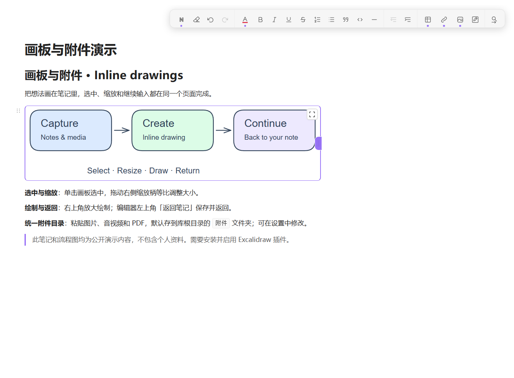

<p align="center">
  
</p>

<h1 align="center">Blo Editor</h1>

<p align="center">A Yuque-inspired block editor for Obsidian. Write, organize, and keep tables, images, and drawings together.</p>

<p align="center"><strong>English</strong> · <a href="README.zh-CN.md">简体中文</a></p>

<p align="center">
  
</p>

Edit content directly and organize ideas by dragging and indenting blocks.
Notes stay in Markdown, with automatic saving, rich copy/paste, and inline drawings.

Insert inline LaTeX with `Ctrl/Cmd+Shift+M`, the formula toolbar button, or `/math`.
Type the source in place, leave the field to render it, and double-click to edit.
Formulas use Obsidian's built-in MathJax and save as `$...$`; no extra rendering plugin is required.

Export the rendered note through the file explorer context menu, tab menu, or **Blo Editor: Export PDF** command,
without another export plugin. Choose A4, A3, or Letter, orientation, margins, title,
and page numbers. PDFs use a light background and preserve code highlighting,
tables, images, and drawing previews.

## A block editing workflow

Alongside Obsidian's native Markdown editor, Blo offers:

**Parent and child blocks.** Drag a parent together with its text, lists, quotes,
tables, and code children. Drop guides show indentation levels; Tab / Shift+Tab
adjust indentation. On an indented empty text block, Backspace removes one level
of indentation before deleting the line. Repeating the active paragraph-style shortcut restores body text.

<details>
<summary>View block dragging and indentation</summary>


</details>

**Hierarchical heading numbers.** Combine heading levels and indentation to
display `1.2.3`, counting only numbered ancestors. Continue/restart rules respect
heading and parent-block boundaries; intervening text and code do not restart
same-level numbering. Restart manually when needed; body lists keep ordinary `1.` markers.
Heading numbers also appear in the native outline.

<details>
<summary>View heading numbers and outline</summary>


</details>

**Table editing by cells, rows, or columns.** Select a rectangle or use row/column
handles and adjust alignment and headers from the floating toolbar. Click to select
a cell; double-click, Enter, or Space to edit, or type to replace its contents.
Tab moves between cells; Shift+arrows extend a rectangle. Backspace/Delete clear
contents; select row/column handles to remove rows/columns. Set default header styles.

<details>
<summary>View table selection and floating controls</summary>


</details>

**Styled copy and paste.** Import Yuque Markdown color tags combined with bold,
underline, lists, and inline code, or paste web HTML. Copy out as standard rich
HTML and plain text. Imported colors map to the toolbar palette; near-black/white
text and neutral backgrounds follow the current theme.
Imported or pasted Markdown images, including Yuque `` tags, are downloaded
to the attachment folder and displayed locally. Failed downloads keep the original
link, and tags inside code remain literal.

<details>
<summary>View imported formatting and theme-aware colors</summary>


</details>

**Inline drawings and attachments.** Drawing previews fit their content. Click to
select, drag to resize proportionally, or place the caret in the right gutter and
press Left to select the drawing. The top-right editor button opens Excalidraw;
**Back to note** saves, closes that drawing tab, and returns to the original note.
Pasted or dropped images, audio, video, PDFs, and other files are saved as
attachments before their previews or links are inserted at the original cursor.
Pasting a recognized image, audio, video, or PDF URL opens a small menu: keep the
text link, or download it to the attachment folder and embed it in the note.
Dismissing the menu or a failed download keeps the original link.
Paste-menu options include icons. The menu closes on focus loss or page scrolling
and does not reopen automatically. Clicking embed closes it immediately while import
continues in the background. Click an existing media link or select its full text to reveal a
**Download as attachment and embed** icon on the right of its popover; hover for its description.
Media detection supports query strings, common CDN suffixes, and media paths inside proxy URLs.
Drag existing vault media from the file explorer to embed it without copying files,
or reference them through **Attachment → Vault**. In editing mode, click a link to
select it, then click again to open it, or Ctrl/Cmd-click to open it directly.
In reading mode, a single click opens the link.

<details>
<summary>View inline drawings and attachments</summary>



</details>

Try the [block structure example](examples/block-structure.md) and
[table and formatting example](examples/tables-and-formatting.md).
For the [drawing and attachment example](examples/drawings-and-attachments.md),
also copy [the sample drawing](examples/inline-drawing.excalidraw.md).
Copy them into your vault and open them with Blo Editor.
The notes contain synthetic content; the screenshots exclude private tabs and the file tree.

## Installation

1. Extract the release ZIP and copy `blo-editor` into your vault's `.obsidian/plugins/`.
2. Restart Obsidian and enable **Blo Editor** under Community plugins.
3. Open a Markdown note. Disable other rich-text editor plugins to avoid competing default views.

Requires desktop Obsidian 1.8.7 or later. Release packages contain no personal
settings, notes, attachments, dependencies, or migration tools.

## Editing and compatibility

Use `/` for commands, the block handle for block actions, and the floating toolbar
for formatting. Find/replace, reading mode, code highlighting, image insertion and
resizing are included. Changes save automatically and before closing; Ctrl+S saves
immediately. Removing embedded images, audio, video, PDFs or drawings keeps the
original by default. The single **Delete attachment when removing an embedded file**
setting moves unreferenced files to trash only within the attachment folder and
its subfolders. Other folders keep originals; an empty path covers root-level
files only. Undo restores attachments and refreshes previews automatically.

Slash commands support Chinese and English names, common aliases, and Chinese
pinyin initials, such as `/bg` for a table or `/math` for a formula.
Commands include 3×3 tables, checkboxes, **Link**, and **Attachment**.
Ctrl/Cmd+K or `/link` opens **Link**: choose a URL or a vault target, then set the
display text and tooltip. This always inserts a text link and has no preview option.
Use `/attachment` or the attachment button for **Vault**, **Import URL**, and
**Computer** sources. Attachments are embedded by default. URL and computer
imports save a local copy in the configured attachment folder; vault references
reuse the existing file. **Content description** describes the attachment and
is kept as image alt text or a preview description. Supported file types show
their content; other files use Obsidian's file embed display.
The separate image button and `/image` command have been removed.
In **Toolbar configuration**, shared
icons and checkboxes control visibility immediately. Paragraph style, clear
formatting, undo, redo, text color, find/replace, table, link, and attachment stay
visible; their settings remain checked, gray, and disabled.

Pasted/imported media and new drawings share the vault-root `附件` folder by default. **Attachment
folder** accepts a vault-relative path such as `Attachments/Media`; leave empty
for the vault root. Changing this setting does not move existing files.
Videos support playback, atomic block selection and the same proportional resizing as images.
Tab / Shift+Tab indent code text unless the entire code block is selected;
the language menu supports typing to search.

Headings 1–4 appear in the outline. Subheadings use H5 styling with extra spacing
and stay out of the outline. Headings can be combined with ordered lists.
The default editor can cover the whole vault or a folder configured in settings.
Leave **Editing scope** empty to include new notes created anywhere in the vault.
**Keep Blo Editor notes in Blo Editor** is enabled by default: existing and restored Blo tabs can open notes outside this scope. Turn it off to switch those notes to the native editor instead.

Common shortcuts: Ctrl+B bold, Ctrl+I italic, Ctrl+U underline, Ctrl+Alt+C text
color, Ctrl+F find, Ctrl+H replace, and Ctrl+Alt+P reading/editing mode.
Commands and custom bindings are available in Obsidian's hotkey settings.

## Optional integrations

Blo Editor works on its own. Enable the following integrations in its settings
when needed; turning them off keeps their dependency plugins and attachments.

Turn on **Enable drawings** to install and activate [Excalidraw](https://github.com/zsviczian/obsidian-excalidraw-plugin), or reuse an existing installation.
Use `/drawing`, the drawing toolbar button, or **Insert drawing** to create an attachment
and embed its preview. Click the preview to select and resize it; use its top-right
**Open drawing editor** button to draw in a full-size Excalidraw tab;
saved changes refresh the preview. **Back to note** saves and returns to the source
note. **Save drawing as** is available at the top right of both the preview and
the full drawing view. Save a vault-relative copy; the current embed stays unchanged
unless **Replace current reference after saving** is checked. Reference updates
support undo. Attachment deletion follows the settings described above.

**Enable image viewer** installs and activates Image Toolkit for enlarged image previews, with adapted toolbar icons and theme styling.
Double-click the caption above the viewer toolbar to edit the current note's image description.
Enter or focus loss saves; Escape cancels. Changes are saved in the note and support undo.

**Enable quick memo panel** connects the desktop-only [Glimmer Memo](https://github.com/OrlandoHsu29/obsidian-glimmer-memo).
Use **Show/hide quick memo panel** to open a floating note with Blo editing,
a compact toolbar, and no duplicate file title. Notes save before the panel hides.
Menus share the main editor's layout and scale together in the memo window.
Activating the window restores editor focus while preserving focus in open dialog inputs.
New memo windows connect automatically; turning the integration off returns
the memo note to the native editor.

If Glimmer Memo is missing, the switch opens GitHub installation instructions;
if installed but disabled, it offers an enable button. Extract the complete ZIP
into the current vault's `.obsidian/plugins/`, keeping all files, including the
Windows global hotkey helper. Click **Check again and enable**; if it is still
not detected, restart Obsidian and try again.

When a dependency plugin (Image Toolkit, Excalidraw, Glimmer Memo) is already enabled, its integration turns on automatically at startup or when the settings open. Switches you turn off yourself are remembered and stay off.

Blo uses Slate. Third-party editing extensions that require Obsidian's native
CodeMirror editor do not automatically apply to this view.

## Development

```sh
npm ci
npm run typecheck
npm run package
```

Use Node.js 22. `npm run package` builds production code and creates a clean
`dist/blo-editor/` folder and `releases/blo-editor-<version>.zip`.
Packaging uses PowerShell on Windows and `zip` on macOS/Linux.
`npm run dev` watches source changes.
See [CONTRIBUTING.md](CONTRIBUTING.md) for the source layout and development rules.

## License

Blo comes from block. Maintained by **OrlandoHsu29**, built on Slate and
[Wysimark Editor](https://github.com/takeshy/obsidian-wysimark) 1.3.2 by Takeshi Morita.
Upstream copyright and the MIT license are retained. See [UPSTREAM.json](UPSTREAM.json)
and [the original README](https://github.com/takeshy/obsidian-wysimark#readme).

MIT. Copyright belongs to the respective upstream authors and OrlandoHsu29 for
Blo Editor modifications. Preserve [LICENSE](LICENSE) and the upstream attribution.
