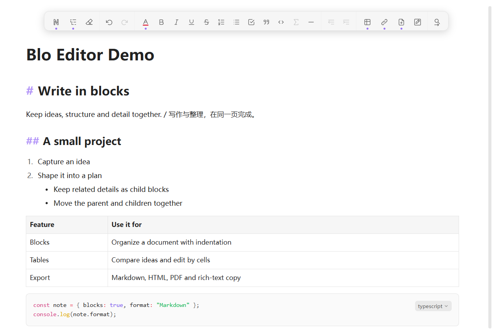
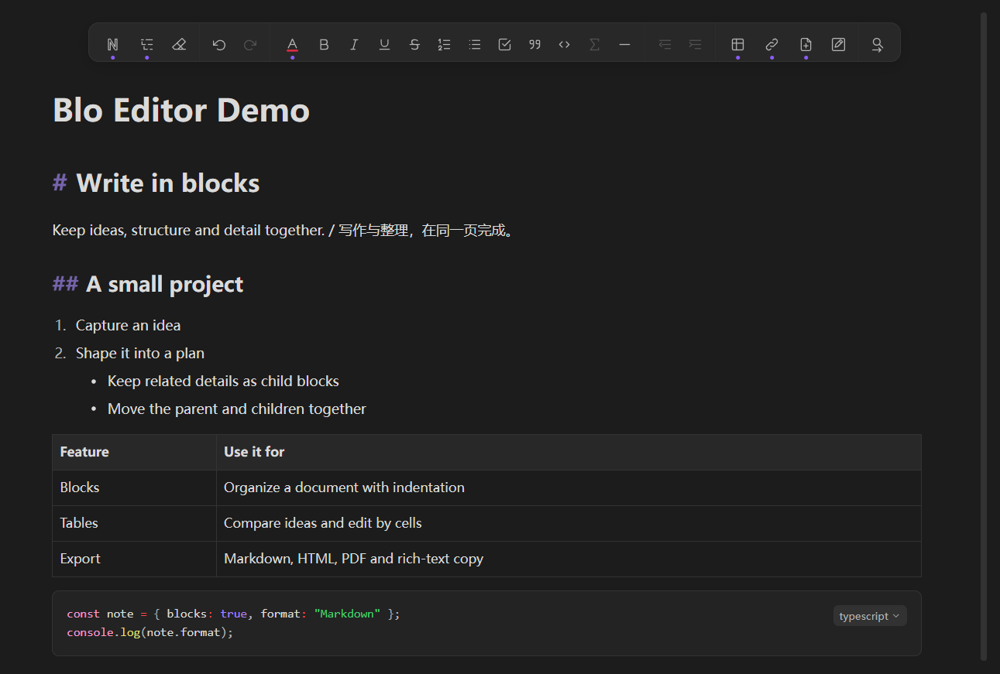
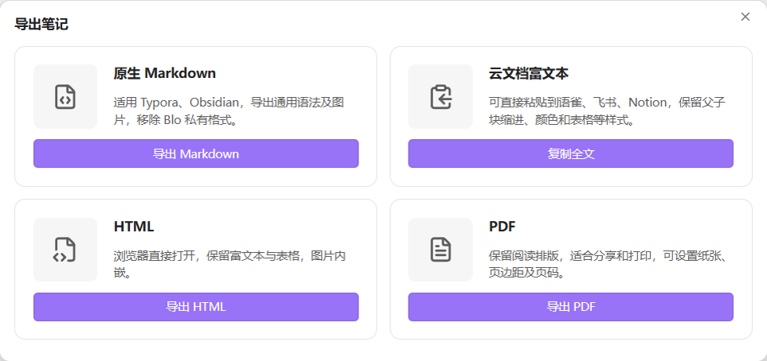
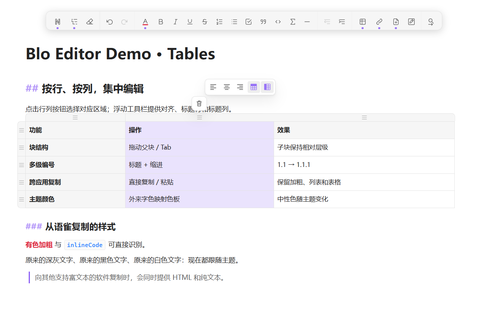
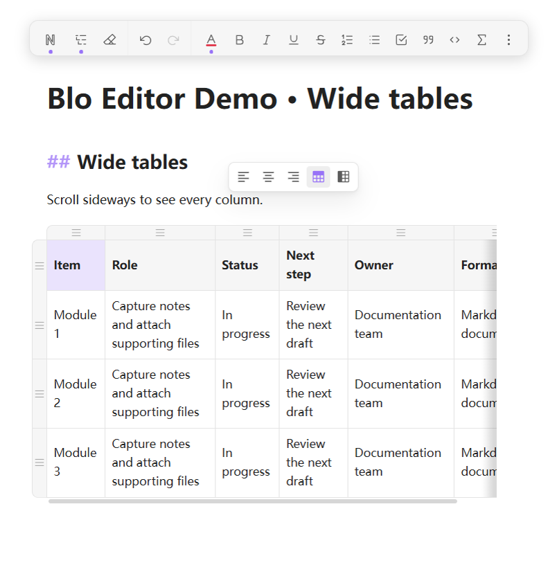
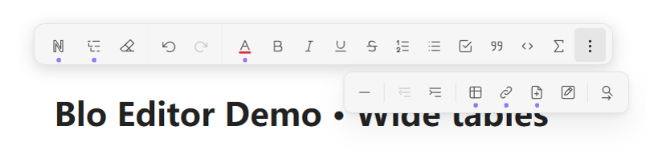

<p align="center">
  
</p>

<h1 align="center">Blo Editor</h1>

<p align="center">A Yuque-inspired block editor for Obsidian. Write, organize, and keep tables, images, and drawings together.</p>

<p align="center"><strong>English</strong> · <a href="README.zh-CN.md">简体中文</a></p>

<details>
<summary>Preview in light and dark mode</summary>

<p align="center">
  
</p>



</details>

Edit content directly and organize ideas by dragging and indenting blocks.
Notes stay in Markdown, with automatic saving, rich copy/paste, and inline drawings.

Insert inline LaTeX with `Ctrl/Cmd+Shift+M`, the formula toolbar button, or `/math`.
Type the source in place, leave the field to render it, and double-click to edit.
Formulas use Obsidian's built-in MathJax and save as `$...$`; no extra rendering plugin is required.

Use the top-right **Export note** button, file explorer context menu, or
**Blo Editor: Export note** command to choose a format without another export plugin:

- **Native Markdown:** standard syntax and local image files for editors such as Typora and Obsidian.
- **Rich text for cloud docs:** copy indentation, colors, and tables for pasting into Yuque, Feishu, or Notion.
- **HTML:** a browser-ready page with embedded local images.
- **PDF:** preserve the reading layout, with paper, orientation, margins, title, and page-number options.

Markdown simplifies Blo-specific formatting; cloud editors determine image and formula support.

<details>
<summary>View note export</summary>



</details>

## A block editing workflow

Choose **Copy block link** from a block handle menu to reference a specific block, including paragraphs, lists, quotes, tables and code. The first copy creates and saves a native Obsidian block ID. Paste the link into another note to jump to the block, or prefix `[[...]]` with `!` to embed its content.

Alongside Obsidian's native Markdown editor, Blo offers:

**Parent and child blocks.** Drag a parent together with its text, lists, quotes,
tables, and code children. Drop guides show indentation levels; Tab / Shift+Tab
adjust indentation. At the start of indented body text, Backspace removes one level
of indentation before deleting or merging. Repeating the active paragraph-style shortcut restores body text.
Ordered lists retain their numbering when switching between body, heading and subtitle styles,
including when toggling the active heading style off. Use the ordered-list control to remove numbering.
Fold ordered/unordered list children with the arrow beside the block handle; folding
persists with the note. Body list hierarchy guides can be toggled in settings; heading lists have no guides.
Body ordered-list shortcuts recognize `1.` through `99.`. Ordered, unordered and task
lists share a text indent. Enter starts a new block without inline color, bold or other marks while retaining its list type.

**Hierarchical heading numbers.** Combine heading levels to display `1.2.3`,
counting only numbered ancestors. Headings and subtitles stay at root depth;
Tab, menus and dragging cannot indent them, but dragging can reorder them. Continue/restart rules respect
heading and parent-block boundaries; intervening text and code do not restart
same-level numbering. Restart manually when needed; body lists keep ordinary `1.` markers.
Heading numbers also appear in the native outline.
The heading-list menu defaults to hash prefixes with H1–H4 all enabled, even in an empty note. Configure absent levels in advance; the note saves these presets and applies them to new headings. Switching heading levels follows the target level's preset, removing the prefix when that level is disabled.

**Table editing by cells, rows, or columns.** Select a rectangle or use row/column
handles and adjust alignment and headers from the floating toolbar. Click to select
a cell; double-click, Enter, or Space to edit, or type to replace its contents.
Tab moves between cells; Shift+arrows extend a rectangle. Backspace/Delete clear
contents; select row/column handles to remove rows/columns. Set default header styles.
Pasting a table into an existing table starts at the selected cell or the top-left cell of the selection. The clipboard grid overwrites the corresponding cells without cropping to the selection; rows and columns are added when needed. Blo, HTML, Markdown and tab-separated tables are supported, with one-step undo for the entire paste.
Narrow panes allow horizontal table overflow, with fading edge hints and a scrollbar
that appears on selection, focus, or hovering its track.
Mouse selection of cells, rows, columns and images keeps the viewport stationary.
Initial layout and pane resizing use a grid placeholder transition; refitting existing
tables waits for scrolling to pause. Clicking images outside tables also keeps their scroll position.

<details>
<summary>View table selection and floating controls</summary>





</details>

**Styled copy and paste.** Import Yuque Markdown color tags combined with bold,
underline, lists, and inline code, or paste web HTML. Copy out as standard rich
HTML and plain text. Imported colors map to the toolbar palette; near-black/white
text and neutral backgrounds follow the current theme.
Imported or pasted Markdown images, including Yuque `` tags, are downloaded
to the attachment folder and displayed locally. Failed downloads keep the original
link, and tags inside code remain literal.

**Inline drawings and attachments.** Drawing previews fit their content. Click to
select, drag to resize proportionally, or place the caret in the right gutter and
press Left to select the drawing. The top-right editor button opens Excalidraw;
**Back to note** saves, closes that drawing tab, and returns to the original note.
Pasted or dropped images, audio, video, PDFs, and other files are saved as
attachments before their previews or links are inserted at the original cursor.
Pasting a recognized image, audio, video, or PDF URL opens a small menu: keep the
text link, or download it to the attachment folder and embed it in the note.
Dismissing the menu or a failed download keeps the original link.
Paste-menu options include icons. The menu closes on focus loss or page scrolling
and does not reopen automatically. Clicking embed closes it immediately while import
continues in the background. Click an existing media link or select its full text to reveal a
**Download as attachment and embed** icon on the right of its popover; hover for its description.
Media detection supports query strings, common CDN suffixes, and media paths inside proxy URLs.
Drag existing vault media from the file explorer to embed it without copying files,
or reference them through **Attachment → Vault**. In editing mode, click link text
to place the caret, or click its leading icon to open the information card.
Ctrl/Cmd-click opens the link directly.
In reading mode, a single click opens the link.
All links show the same leading icon, including bare URLs and internal links.
Icon-only citations use two-step Backspace selection/deletion; visible link text
supports ordinary character editing.
Selecting only link text, even the entire label, keeps the icon out of the
selection so typing replaces the label while retaining its target. Click the
icon or drag across it to select and cut the complete link.
Enter spaces as the display text to show only the link icon. Spaces collapse
to one stored blank label without taking visible text width, including after reopening.

Try the [block structure example](examples/block-structure.md) and
[table and formatting example](examples/tables-and-formatting.md).
For the [drawing and attachment example](examples/drawings-and-attachments.md),
also copy [the sample drawing](examples/inline-drawing.excalidraw.md).
Copy them into your vault and open them with Blo Editor.
The notes contain synthetic content; the screenshots exclude private tabs and the file tree.

## Installation

1. Extract the release ZIP and copy `blo-editor` into your vault's `.obsidian/plugins/`.
2. Restart Obsidian and enable **Blo Editor** under Community plugins.
3. Open a Markdown note. Disable other rich-text editor plugins to avoid competing default views.

Requires desktop Obsidian 1.8.7 or later. Release packages contain no personal
settings, notes, attachments, dependencies, or migration tools.

## Editing and compatibility

Use `/` for commands, the block handle for block actions, and the floating toolbar
for formatting. Find/replace, reading mode, code highlighting, image insertion and
resizing are included. Changes save automatically and before closing; Ctrl+S saves
immediately. When a Blo view shares a note with another Blo or native Markdown view, switching views saves pending edits before loading the latest file. If edits conflict, Blo keeps the original and saves a separate `Blo conflict` copy; use the reload button after reviewing the copy.

Removing embedded images, audio, video, PDFs or drawings keeps the
original by default. The single **Delete attachment when removing an embedded file**
setting moves unreferenced files to trash only within the attachment folder and
its subfolders. Other folders keep originals; an empty path covers root-level
files only. Undo restores attachments and refreshes previews automatically.

Slash commands support Chinese and English names, common aliases, and Chinese
pinyin initials, such as `/bg` for a table or `/math` for a formula.
Commands include 3×3 tables, checkboxes, **Link**, and **Attachment**.
Ctrl/Cmd+K or `/link` opens **Link**: choose a URL or a vault target, then set the
display text and tooltip. This always inserts a text link and has no preview option.
Use `/attachment` or the attachment button for **Vault**, **Import URL**, and
**Computer** sources. Attachments are embedded by default. URL and computer
imports save a local copy in the configured attachment folder; vault references
reuse the existing file. **Content description** describes the attachment and
is kept as image alt text or a preview description. Supported file types show
their content; other files use Obsidian's file embed display.
The separate image button and `/image` command have been removed.
Narrow panes collect overflowing controls in a horizontal icon menu under the
three-dot button; click again to collapse it. Optional tools are collected first,
from right to left. Only after all optional tools are collected do the primary
tools retained in Glimmer Memo begin moving into the menu, also from right to left.
The remaining controls keep their original order.

<details>
<summary>View the responsive toolbar</summary>



</details>

Pasted/imported media and new drawings share the vault-root `附件` folder by default. **Attachment
folder** accepts a vault-relative path such as `Attachments/Media`; leave empty
for the vault root. Changing this setting does not move existing files.
Videos support playback, atomic block selection and the same proportional resizing as images.
Tab / Shift+Tab indent code text unless the entire code block is selected;
the language menu supports typing to search.

Headings 1–4 appear in the outline. Subheadings use H5 styling with extra spacing
and stay out of the outline. Headings can be combined with ordered lists.
The default editor can cover the whole vault or a folder configured in settings.
Leave **Editing scope** empty to include new notes created anywhere in the vault.
**Keep Blo Editor notes in Blo Editor** is enabled by default: existing and restored Blo tabs can open notes outside this scope. Turn it off to switch those notes to the native editor instead.

Common shortcuts: Ctrl+B bold, Ctrl+I italic, Ctrl+U underline, Ctrl+Alt+C text
color, Ctrl+F find, Ctrl+H replace, and Ctrl+Alt+P reading/editing mode.

Ctrl/Cmd+A first selects only the current block's contents. Backspace clears the text while keeping list markers, heading formatting and code-block frames; another Backspace removes an empty list's marker. Press Ctrl/Cmd+A again to select the entire document, including block structures. Turn off **Progressive selection with Ctrl/Cmd+A** in the plugin settings to select the document immediately. Block handles continue to select whole blocks and their children.
While editing a formula, Ctrl/Cmd+A stays inside its source input on every press.
Search **Blo Editor** in **Settings → Hotkeys** to customize formatting, headings, lists, quotes, indentation and links separately from native editor commands. Rebinding or removing shortcuts takes effect immediately. **Configure hotkeys** in the plugin settings opens this filtered list. **Blo Editor: Strikethrough** defaults to Ctrl/Cmd+Shift+X.

## Write Blo notes with AI

In **Settings → Blo Editor → Write notes with AI**, click **Copy installation prompt** and paste it into an AI client with local file access. The AI can install the bundled `blo-editor-notes` Skill using its own supported installation mechanism, learning parent/child blocks, indentation, folding, heading numbering, colors, tables and editable drawing attachments. Copy the prompt again after plugin updates to update the Skill.

The complete folder is available at `skills/blo-editor-notes/` inside the plugin directory; you can also provide that folder to your AI. Click **View prompt** to open a preview. It contains local paths, but no note content. The Skill does not grant file access; chat-only clients need you to provide the files. Drawings still require Excalidraw.

To make Blo the default note format in this directory, click **Generate AGENTS.md** in the same section. The file is generated in the configured editing folder, or at the vault root when the scope is empty. Existing files receive only a marked Blo section; other instructions are preserved. The rules link to the bundled Skill, which can be read without installing it separately. Your AI client must support directory instructions and include the relevant directory in its workspace; existing sessions may need reopening. Installing or starting the plugin does not generate this file. After changing the editing scope, generate it again at the new location; old rules are not moved or deleted automatically.

## Optional integrations

Blo Editor works on its own. Enable the following integrations in its settings
when needed; turning them off keeps their dependency plugins and attachments.

Turn on **Enable drawings** to install and activate [Excalidraw](https://github.com/zsviczian/obsidian-excalidraw-plugin), or reuse an existing installation.
Use `/drawing`, the drawing toolbar button, or **Insert drawing** to create an attachment
and embed its preview. Click the preview to select and resize it; use its top-right
**Open drawing editor** button to draw in a full-size Excalidraw tab;
saved changes refresh the preview. **Back to note** saves and returns to the source
note. **Save drawing as** is available at the top right of both the preview and
the full drawing view. Save a vault-relative copy; the current embed stays unchanged
unless **Replace current reference after saving** is checked. Reference updates
support undo. Attachment deletion follows the settings described above.

**Enable image viewer** installs and activates Image Toolkit for enlarged image previews, with adapted toolbar icons and theme styling.
Double-click the caption above the viewer toolbar to edit the current note's image description.
Enter or focus loss saves; Escape cancels. Changes are saved in the note and support undo.

**Enable quick memo panel** connects the desktop-only [Glimmer Memo](https://github.com/OrlandoHsu29/obsidian-glimmer-memo).
Use **Show/hide quick memo panel** to open a floating note with Blo editing,
a compact toolbar, and no duplicate file title. Additional tools are available
under the three-dot button; narrower windows collect overflowing primary tools
in the same menu. Notes save before the panel hides.
Menus share the main editor's layout and scale together in the memo window.
Activating the window restores editor focus while preserving focus in open dialog inputs.
New memo windows connect automatically; turning the integration off returns
the memo note to the native editor.

If Glimmer Memo is missing, the switch opens GitHub installation instructions;
if installed but disabled, it offers an enable button. Extract the complete ZIP
into the current vault's `.obsidian/plugins/`, keeping all files, including the
Windows global hotkey helper. Click **Check again and enable**; if it is still
not detected, restart Obsidian and try again.

When a dependency plugin (Image Toolkit, Excalidraw, Glimmer Memo) is already enabled, its integration turns on automatically at startup or when the settings open. Switches you turn off yourself are remembered and stay off.

Blo uses Slate. Third-party editing extensions that require Obsidian's native
CodeMirror editor do not automatically apply to this view.

## Development

```sh
npm ci
npm run typecheck
npm run package
```

Use Node.js 22. `npm run package` builds production code and creates a clean
`dist/blo-editor/` folder and `releases/blo-editor-<version>.zip`.
Packaging uses PowerShell on Windows and `zip` on macOS/Linux.
`npm run dev` watches source changes.
See [CONTRIBUTING.md](CONTRIBUTING.md) for the source layout and development rules.

## License

Blo comes from block. Maintained by **OrlandoHsu29**, built on Slate and
[Wysimark Editor](https://github.com/takeshy/obsidian-wysimark) 1.3.2 by Takeshi Morita.
Upstream copyright and the MIT license are retained. See [UPSTREAM.json](UPSTREAM.json)
and [the original README](https://github.com/takeshy/obsidian-wysimark#readme).

MIT. Copyright belongs to the respective upstream authors and OrlandoHsu29 for
Blo Editor modifications. Preserve [LICENSE](LICENSE) and the upstream attribution.
