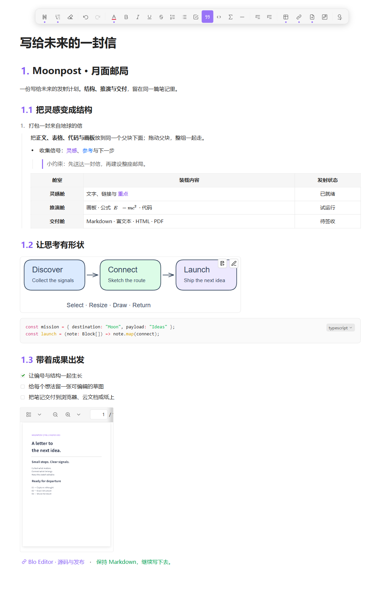
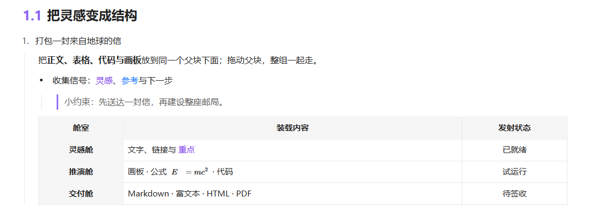
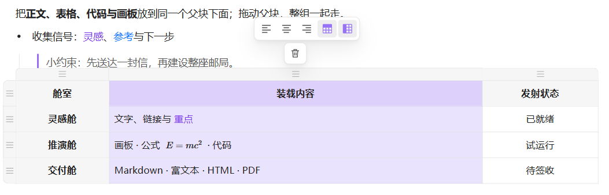
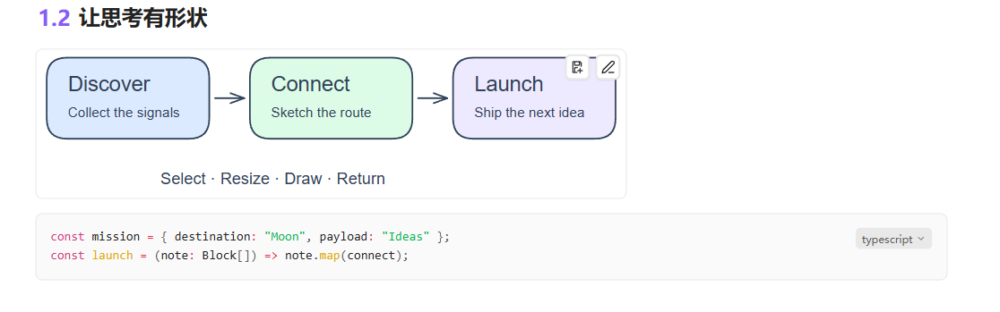
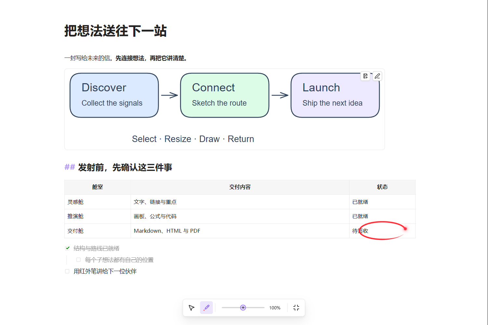
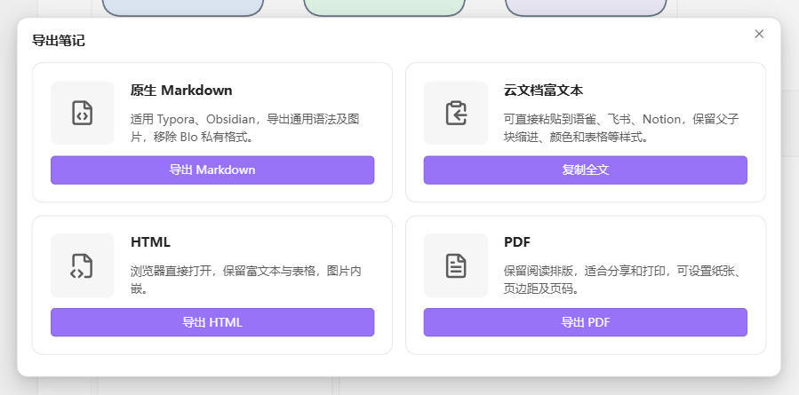

  

<h1 align="center">Blo Editor</h1>

A Yuque-inspired block editor for Obsidian. Give your ideas structure, sketch the connections, and keep writing in Markdown.

<strong>English</strong> · <a href="README.zh-CN.md">简体中文</a>

The **Moonpost** demo brings a small project's plan, sketches and deliverables into one note. These are real editor screenshots, using synthetic content.

## Structure beyond a list

Nest paragraphs, tables, quotes, code and media under the same parent. Drag the parent to move the group, use Tab / Shift+Tab to adjust depth, and fold list children when you need less detail. Hierarchy guides keep the relationships visible.

Heading numbers such as **1.2.3** follow the actual heading levels and appear in Obsidian's native outline. Body lists keep their own numbering.

## Tables that you can work in

Select cells, rectangles, rows or columns; adjust alignment and header rows/columns from the floating toolbar. Paste a grid at the selected cell to fill and expand the table, with one-step undo. Wide tables scroll horizontally with directional edge hints.

## Text, sketches and references together

Embed editable **Excalidraw** drawings, resize their previews, open the drawing to work on it, then return to the note. Combine them with syntax-highlighted code, LaTeX formulas, colors, highlights and task lists.

Images and PDFs have resizable previews; PDFs retain their toolbar and page navigation. Media links can be downloaded into the attachment folder and embedded as separate blocks. Native Obsidian block links connect specific ideas across notes.

Task lists have hierarchy guides too. Completing a parent fades and strikes through its children; unchecking it restores their appearance while preserving each child's own checkbox state.

## Present straight from your note

**Presentation mode** puts your note in a centered fullscreen view with whole-content zoom. Highlight ideas with a laser pointer: its trail follows page scrolling and fades after release.

## Take the note with you

Export **Markdown**, copy **rich text for cloud documents**, or save **HTML** and **PDF**. HTML and PDF preserve rendered details such as drawings, formulas, code highlighting and hierarchy guides. Markdown and cloud-document output favor portable content; PDFs and drawing attachments become links where inline rendering is unsupported. Embedded PDF previews become static pages in HTML/PDF exports.

Also included: `/` commands, find/replace, automatic saving, reading mode and an optional floating memo integration. The bundled **blo-editor-notes** Skill helps file-capable AI tools write Blo's block structure, tables and editable drawings. Copy its installation/update prompt from **Settings → Blo Editor → AI collaboration** and give it to your AI tool.

## Try it

1. Download the ZIP from [Releases](https://github.com/OrlandoHsu29/obsidian-blo-editor/releases), and extract `blo-editor/` into your vault's `.obsidian/plugins/`.
2. Restart Obsidian and enable **Blo Editor** under Community plugins. Preserve `data.json` when upgrading.
3. Copy the [demo note](examples/feature-tour.md), [drawing](examples/feature-tour.excalidraw.md) and [PDF](examples/feature-tour.pdf) into the same vault folder, then open the note with Blo Editor.

Requires **desktop Obsidian 1.8.7+**. Drawing previews and editing require Excalidraw; the drawing integration in Blo settings can install and enable it. Optional integrations include Image Toolkit and [Glimmer Memo](https://github.com/OrlandoHsu29/obsidian-glimmer-memo).

Notes remain Markdown, with extension metadata for Blo-specific structure. Blo uses **Slate + React**; plugins that depend on Obsidian's native CodeMirror editor do not automatically apply. Cloud-document applications determine which pasted formatting they retain.

## Development & credits

Use Node.js 22: `npm ci`, `npm run typecheck`, then `npm run package`. See [CONTRIBUTING.md](CONTRIBUTING.md).

Blo comes from *block*. Maintained by **OrlandoHsu29**, based on [Wysimark Editor](https://github.com/takeshy/obsidian-wysimark) by **Takeshi Morita**. The upstream copyright and MIT license are retained; see [LICENSE](LICENSE) and [UPSTREAM.json](UPSTREAM.json).
