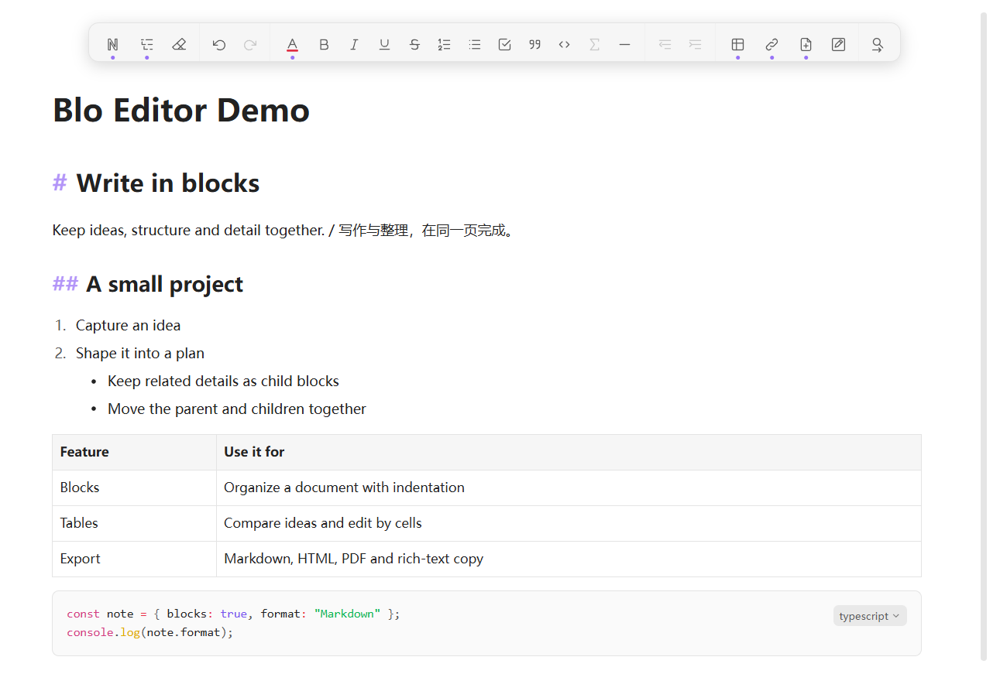
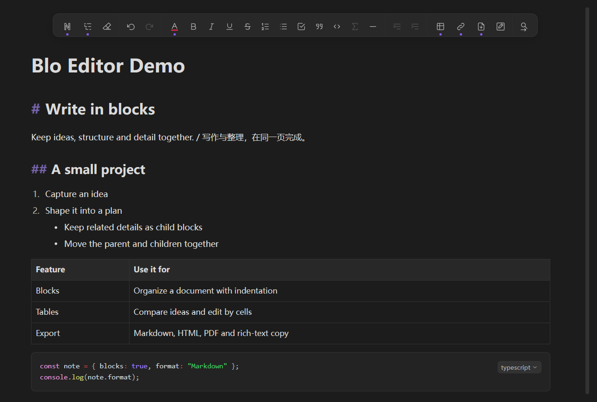
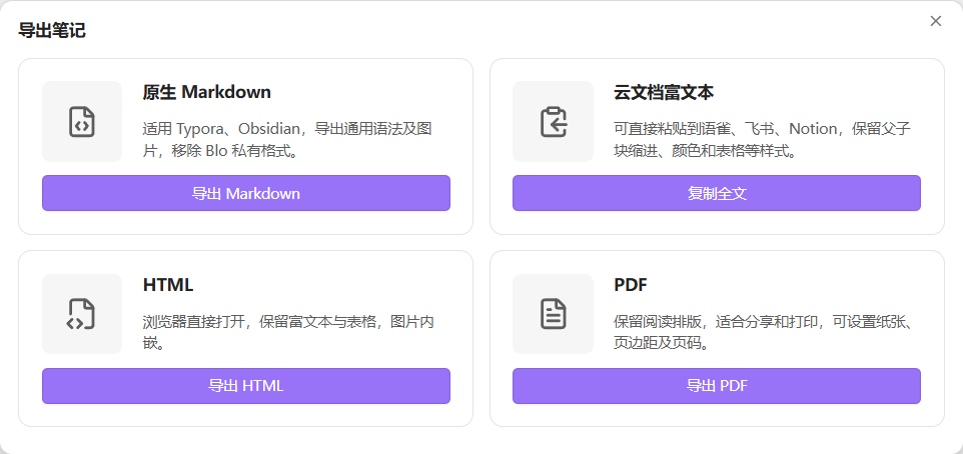
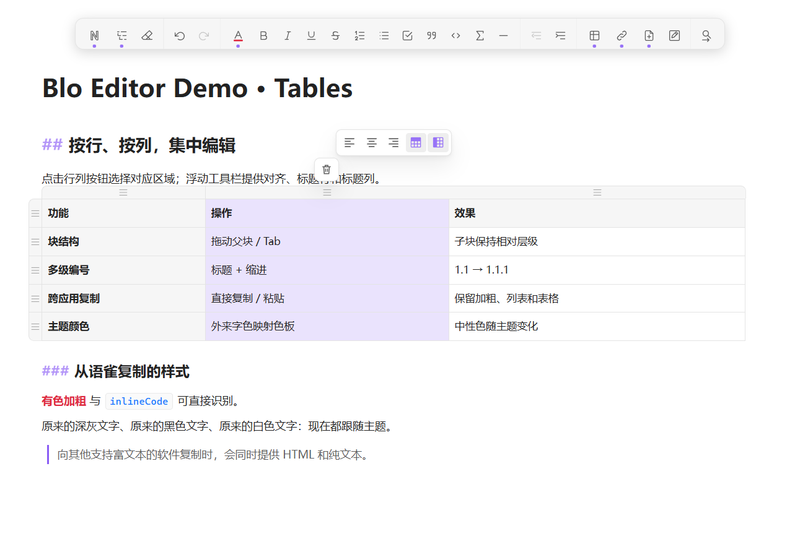
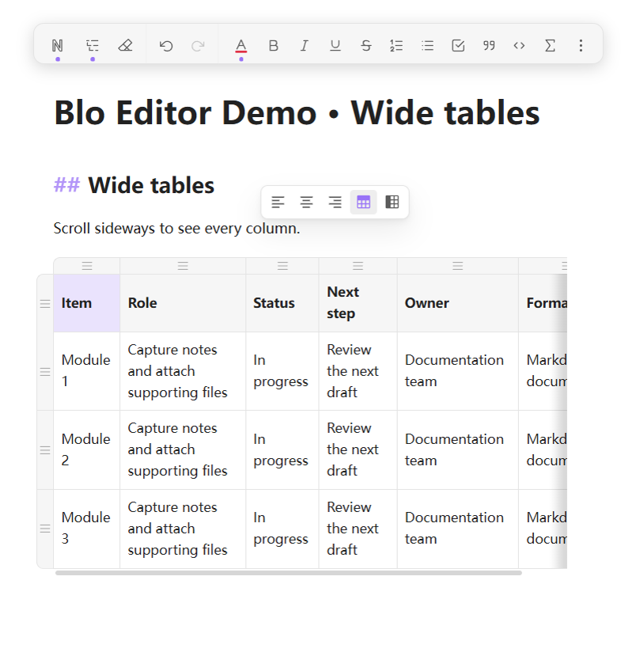
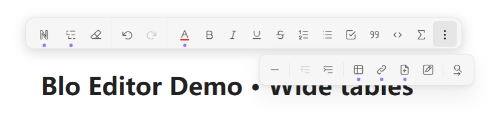

  

<h1 align="center">Blo Editor</h1>

语雀风格的 Obsidian 块编辑器。写笔记、整理结构，把表格、图片和画板放在同一页。

<a href="README.md">English</a> · <strong>简体中文</strong>

展开查看深浅色预览

  

直接编辑内容，用块拖动与缩进整理思路。笔记仍保存为 Markdown，自动保存，支持带样式复制粘贴与内嵌画板。

通过 `Ctrl/Cmd+Shift+M`、工具栏公式按钮或 `/公式` 插入行内 LaTeX。
在原位置输入源码，失焦后渲染，双击公式重新编辑。复用 Obsidian 自带 MathJax，保存为 `$...$`，无需额外安装公式渲染插件。

通过右上角「导出笔记」按钮、文件浏览器右键菜单或「Blo Editor：导出笔记」命令选择格式，无需额外导出插件：

- **原生 Markdown**：导出通用语法与本地图片，适合 Typora、Obsidian 等编辑器。
- **云文档富文本**：复制父子块缩进、颜色和表格，粘贴到语雀、飞书、Notion 等云文档。
- **HTML**：浏览器直接打开，本地图片内嵌。
- **PDF**：保留阅读排版，可设置纸张、方向、页边距、标题及页码。

Markdown 会简化 Blo 私有样式；云文档对图片和公式的支持取决于目标平台。

展开查看导出选项

## 与原生 Markdown 编辑入口不同的体验

**父子块操作**：正文、列表、引用、表格和代码都能组成块层级；拖动父块时包含子块。
块柄菜单的「复制块链接」可引用具体块，不限于标题；首次复制会自动保存原生块 ID。将链接粘贴到其他笔记即可跳转，在 `[[...]]` 前加 `!` 可嵌入该块内容。
拖动参考线显示目标缩进层级，Tab / Shift+Tab 调整缩进；有缩进的正文在开头按 Backspace 先减少一级缩进，再按原有规则删除或合并。重复按当前段落样式的快捷键可恢复正文。有序列表在正文、标题、子标题间切换或取消当前标题样式时保留编号；需要取消编号时，使用有序列表按钮。
有序、无序列表父项可通过块柄旁的箭头折叠子块，折叠状态随笔记保存。正文列表层级竖线可在设置中开关，标题列表不显示竖线。
正文有序列表自动识别 `1.`～`99.`；有序、无序和任务列表的正文起点保持对齐。回车新增块会清除颜色、加粗等行内格式，保留列表类型。

**标题多级编号**：结合标题级别显示 `1.2.3`，只计入实际编号的上级。标题与子标题固定在顶层，不接受 Tab、菜单或拖动缩进；拖动仍可调整顺序。
默认延续同级编号，正文或代码块不会让序列意外重启；可手动重新编号。编号遵守标题和父块边界，正文列表仍用普通 `1.` 格式，并同步显示在原生大纲中。

**按区域编辑表格**：支持单元格、矩形区域、整行和整列选择；悬浮工具栏调整对齐、标题行和标题列，
单击选格，双击、回车或空格进入编辑；直接输入可替换内容。Tab 切格，Shift+方向键扩展矩形选区，Backspace / Delete 清空内容；通过行列按钮选择后才删除行列。新建表格的默认标题样式可配置。
在表格中粘贴另一张表格时，以单格或选区左上角为起点，按剪贴板行列逐格覆盖；不会按选区大小裁剪，空间不足时自动补足行列。支持 Blo 表格、网页表格、Markdown 表格及制表符分隔的数据，整次粘贴可一步撤销。
窄窗口下表格支持横向溢出，左右渐隐光晕提示隐藏内容；选中、聚焦或悬停底部轨道时显示滚动条。
点选单元格、行列或图片时保持滚动位置；首次排版和调整窗口宽度时使用网格占位过渡，滚动时延后已有表格的宽度试算。表格外的图片点选同样不会自动滚动居中。

展开查看表格选区与悬浮工具栏截图

**带样式复制粘贴**：兼容语雀 Markdown 的颜色标签与加粗、下划线、列表、行内代码组合，也支持网页 HTML 粘贴。
向外复制同时提供标准富文本 HTML 和纯文本。外来字色映射到固定色板，近黑／近白字色与中性底色跟随主题。
导入或粘贴 Markdown 时，网络图片（含语雀的 `` 标签）会下载到附件目录并改用本地预览；下载失败保留原链接，代码里的标签保持原样。

**内嵌画板与附件**：画板预览与绘制内容贴合，单击选中、拖动等比缩放；右侧空白可放置光标，向左一格选中整个画板。
右上角「放大绘制」打开完整 Excalidraw 编辑器，左上角「返回笔记」保存并回到原笔记。
粘贴或拖入图片、音视频、PDF 和其他文件时，先存附件，再在原光标位置插入预览或链接。
粘贴可识别的图片、音视频或 PDF 网址时，会弹出小菜单，可保留文本链接，或下载到附件目录并嵌入笔记；关闭菜单或下载失败时保留原链接。
粘贴菜单的选项带图标，失焦或滚动页面后关闭，不再自动弹出；点击嵌入后立即关闭，后台完成导入。选中已有媒体链接（单击或完整选中链接文字）后，链接浮层右侧提供「下载为附件并嵌入」图标，悬停查看说明。支持带查询参数、常见 CDN 后缀和代理网址中的媒体路径。
库内已有的图片、画板等媒体可从文件浏览器直接拖入，引用原文件而不复制；也可通过「附件 → 本地库」嵌入。编辑模式下，单击链接文字定位光标，单击前方图标打开信息卡，Ctrl/Cmd 单击直接打开链接；阅读模式直接单击打开。所有链接统一显示前方图标，包括纯网址和内部链接；仅图标的空白引用保留第一次退格选中、第二次删除，文字链接按字符正常编辑。显示文字只填空格时仅显示图标，不占文字宽度；多个空格统一保存为一个空白标签，重新打开后仍保留。

可直接试用 [块结构示例](examples/block-structure.md) 和 [表格与排版示例](examples/tables-and-formatting.md)。
画板示例见 [画板与附件示例](examples/drawings-and-attachments.md)，需同时复制 [示例画板](examples/inline-drawing.excalidraw.md)。
将示例复制到笔记库，用 Blo Editor 打开即可。
示例内容均为专门编写的演示资料，截图不包含私人标签页和文件树。

## 安装与使用

解压安装包，将 `blo-editor` 放入笔记库的 `.obsidian/plugins/`，
重启 Obsidian 后在第三方插件中启用 **Blo Editor**。需要桌面版 Obsidian 1.8.7 或更新版本。

输入 `/` 打开命令菜单，点击块柄进行块操作，悬浮工具栏调整格式。
斜杠菜单支持中英文名称、常用别名和拼音首字母检索，例如 `/bg` 查找表格、`/math` 查找公式。支持默认 3×3 表格、复选框、「链接」和「附件」。
Ctrl/Cmd+K 或 `/链接` 打开「链接」：选择网址或笔记库目标，填写显示文字和悬停提示；始终插入文字链接，不提供预览选项。
只选链接文字（包括选满全部文字）时不选中图标，输入会替换文字并保留链接地址；点击图标或实际拖选经过图标后，才选中整条链接，剪切会移除整个链接。显示文字留空会使用链接地址，开启自动标题时优先获取网页标题；只填空格则仅显示图标。
`/附件` 或附件按钮打开独立的附件弹窗，顶部通过「本地库、网址导入、电脑导入」切换。附件默认嵌入；网址和电脑导入先保存到设置中的附件目录，本地库直接引用原文件。「内容描述」用于说明附件，保留为图片替代文字或预览说明。支持的文件类型显示内容，其他文件使用 Obsidian 的文件嵌入显示。独立图片按钮和 `/图片` 项已移除。
窄窗口的溢出按钮收纳到「三点」下方的横向图标菜单，再点一次收起。优先从右到左收纳非必要工具；全部收纳后，再从右到左收纳 Glimmer Memo 主栏保留的必要工具。留在主栏的按钮保持原有顺序。

展开查看工具栏溢出收纳

支持查找替换、阅读模式、代码高亮及图片插入和缩放。正文自动保存，关闭标签页前也会保存，Ctrl+S 可立即保存。

同一笔记同时在 Blo 和另一 Blo 或原生 Markdown 视图中打开时，切换视图会先保存待写入的修改，再载入最新文件。若修改发生冲突，Blo 会保留原文件并另存一份 `Blo conflict` 副本；检查副本后，可使用重新载入按钮继续编辑。

删除块及其子块支持撤销。内嵌图片、音视频、PDF 和画板默认只删除引用；可开启「删除内嵌文件时删除附件」，仅将附件目录及子目录内、无其他引用的文件移入回收站，撤销时恢复并刷新预览。其他目录保留源文件；附件路径留空时仅限库根目录文件。

粘贴或导入的媒体和新画板默认保存在库根目录的 `附件` 文件夹。设置中的「附件保存路径」支持库内相对路径，如 `附件/素材`；留空保存到库根目录。更改设置不会迁移已有文件。视频支持播放、块选中和与图片相同的等比缩放。
代码块内 Tab / Shift+Tab 调整代码缩进，只有整个代码块被选中时才调整块缩进；语言菜单支持输入搜索。

标题 1～4 显示在大纲，子标题保留 H5 样式和较大间距但不进入大纲。
标题可以搭配有序列表。可在插件设置中关闭默认富文本入口，或限定自动打开的文件夹范围。
将“编辑范围”留空，整个库中任意位置新建的笔记都可默认使用插件。
“已有 Blo Editor 格式的笔记仍用 Blo Editor 打开”默认开启：已有或恢复的 Blo 标签页可继续打开范围外的笔记；关闭后，这些笔记会切回原生编辑器。

Ctrl+B 加粗，Ctrl+I 斜体，Ctrl+U 下划线，Ctrl+Alt+C 切换字体颜色，
Ctrl+F 查找，Ctrl+H 替换，Ctrl+Alt+P 切换阅读与编辑。
更多快捷键在 Obsidian 设置中搜索 **Blo Editor**。

### 让 AI 按 Blo 格式写笔记

在 **设置 → Blo Editor → AI 写笔记** 点击「复制安装提示词」，粘贴给能够访问本地文件的 AI。AI 会按其客户端的安装方式安装随插件提供的 `blo-editor-notes` Skill，学习父子块缩进、折叠、标题编号、颜色、表格及可编辑画板附件格式。插件更新后可再次复制提示词，让 AI 更新 Skill。

Skill 位于插件目录的 `skills/blo-editor-notes/`，也可将整个文件夹提供给 AI；点击「查看提示词」可打开预览。提示词包含本机路径，不含笔记正文。Skill 不授予文件访问权限；纯聊天 AI 需要用户提供文件。画板仍需启用 Excalidraw。

希望 AI 在这个目录写笔记时默认使用 Blo 格式，可点击同一区域的「生成 AGENTS.md」。文件生成在当前「编辑范围」指定的文件夹中；范围留空则放在知识库根目录。已有文件仅添加或更新带标记的 Blo 规则段，其他内容保留。规则链接到随插件提供的 Skill，未单独安装时也可直接读取。AI 客户端需支持目录规则，并将相应目录纳入工作区；已有会话可能需要重新开启才能加载。安装或启动插件不会生成此文件；改变编辑范围后需在新位置再次点击生成，旧规则不会自动迁移或删除。

## 扩展功能

Blo Editor 可独立使用，按需在设置中开启以下扩展；关闭开关只停用 Blo 集成，保留依赖插件与附件。

开启「启用画板」，会自动安装并启用 [Excalidraw](https://github.com/zsviczian/obsidian-excalidraw-plugin)；已安装时直接复用。
通过 `/画板`、工具栏画板按钮或“插入画板”命令创建附件并内嵌预览；点击预览选中并调整大小，通过右上角“放大绘制”按钮在完整的 Excalidraw 标签页中编辑，
保存后自动刷新预览，通过左上角「返回笔记」保存并回到原笔记。预览和完整画板右上角均提供「另存为」，可将副本保存到库内相对路径；默认保留原引用，勾选「另存后替换当前引用」可更新对应引用，并支持撤销。是否同步删除附件由上述设置控制。

「启用图片查看器」会自动安装并启用 Image Toolkit，支持放大查看图片，并适配了工具栏图标和主题样式。
双击查看器工具栏上方的描述，可修改当前笔记中的图片描述；回车或失焦保存，Esc 取消。修改写回笔记并支持撤销。

「启用速记面板」接入仅支持桌面端的 [Glimmer Memo](https://github.com/OrlandoHsu29/obsidian-glimmer-memo)。用「打开/关闭速记面板」命令呼出浮窗，笔记使用 Blo 编辑，隐藏重复文件标题、使用紧凑工具栏；其余工具放在「三点」菜单中，窗口变窄时主栏放不下的按钮也收进同一菜单。面板隐藏前会先保存。新建的速记窗口也会自动接入；关闭开关后，速记笔记切回原生编辑器。
二级菜单与主编辑器共用布局，在速记窗口中整体缩放。窗口激活后会恢复编辑器焦点，同时保留已打开弹窗中输入框的焦点。

Glimmer Memo 未安装时，开启开关会显示 GitHub 安装指引；已安装但未启用时提供启用按钮。将完整 ZIP 解压到当前库的 `.obsidian/plugins/`，保留全部文件，包括 Windows 全局快捷键程序。然后点击「重新检测并启用」；如仍未检测到，请重启 Obsidian 后重试。

三个依赖插件（Image Toolkit、Excalidraw、Glimmer Memo）只要已经启用，对应开关会在启动或打开设置时自动开启；手动关闭的开关会记住，不会被自动打开。
底层编辑器是 Slate，依赖原生 CodeMirror 接口的第三方编辑插件需要单独适配。

## 构建

使用 Node.js 22，依次执行 `npm ci`、`npm run typecheck`、`npm run package`。
安装文件生成在 `dist/blo-editor/`，安装包 ZIP 生成在项目的 `releases/` 文件夹，文件名随版本变化。
Windows 使用 PowerShell 打包，macOS/Linux 需要 `zip` 命令。产物不包含个人设置、笔记、附件或迁移工具。
项目结构和维护约定见 [CONTRIBUTING.md](CONTRIBUTING.md)。

## 开源协议

Blo 取自 block。作者：OrlandoHsu29。基于 Takeshi Morita 的 Wysimark Editor 1.3.2 二次开发，底层为 Slate；保留原作者版权、MIT 许可证及 [上游来源记录](UPSTREAM.json)。

本项目采用 [MIT License](LICENSE)。Blo Editor 的修改部分版权归 OrlandoHsu29 所有；保留 Takeshi Morita 的上游版权声明和许可证。
