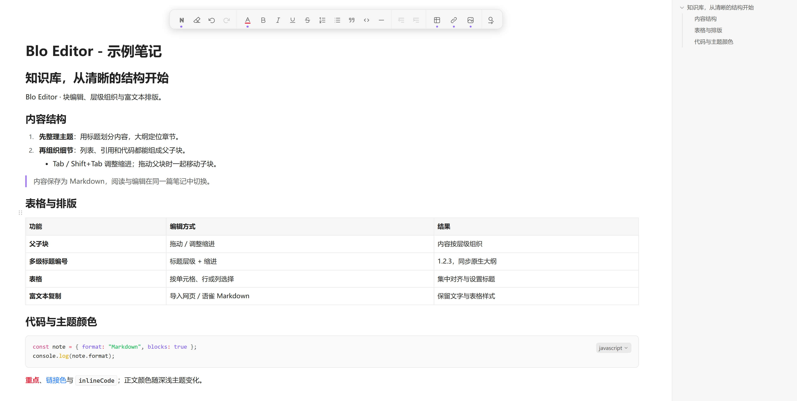
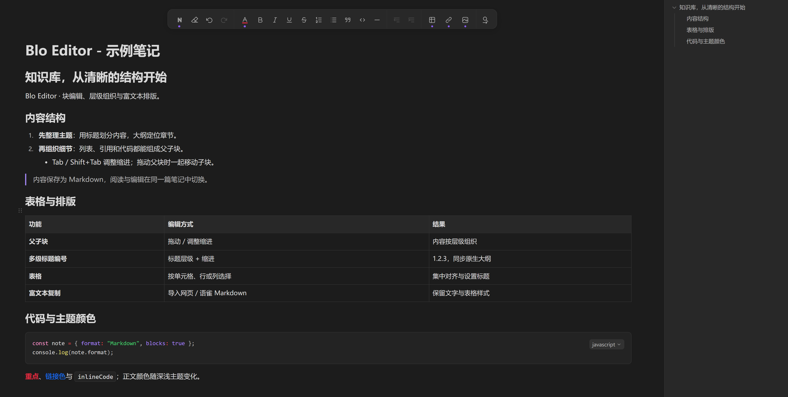
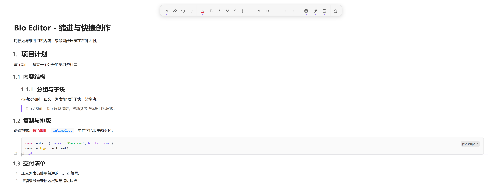
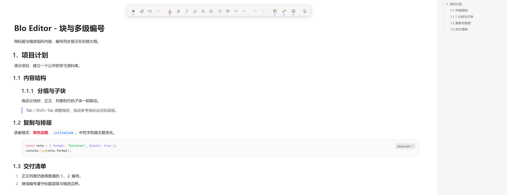
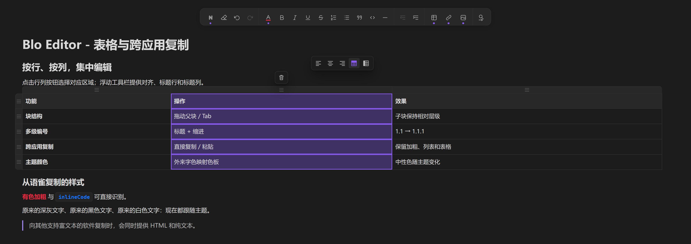
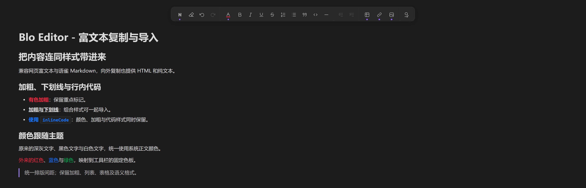

# Blo Editor

  

Blo 取自 block。遵循语雀编辑习惯的 Obsidian 块编辑器，底层使用 Slate。

作者：OrlandoHsu29。基于 Takeshi Morita 的 Wysimark Editor 1.3.2 二次开发，
保留原作者版权、MIT 许可证和上游来源记录。

## 整体预览

浅色模式：标题、列表、表格、代码与原生大纲的整体效果。

深色模式：同一篇示例笔记随主题切换。

点击图片可查看高分辨率 PNG 原图。

## 与原生 Markdown 编辑入口不同的体验

**父子块操作**：正文、列表、引用、表格和代码都能组成块层级；拖动父块时包含子块。
拖动参考线显示目标缩进层级，Tab / Shift+Tab 调整缩进。重复按当前段落样式的快捷键可恢复正文。

展开查看块拖动与缩进截图

**标题多级编号**：结合标题级别与缩进显示 `1.2.3`，只计入实际编号的上级。
继续／重新编号遵守标题和父块边界，正文列表仍用普通 `1.` 编号；编号同步显示在原生大纲中。

展开查看标题编号与大纲截图

**按区域编辑表格**：支持单元格、矩形区域、整行和整列选择；悬浮工具栏调整对齐、标题行和标题列，
行列按钮处可插入，Backspace / Delete 可删除选中的行列。新建表格的默认标题样式可配置。

展开查看表格选区与悬浮工具栏截图

**带样式复制粘贴**：兼容语雀 Markdown 的颜色标签与加粗、下划线、列表、行内代码组合，也支持网页 HTML 粘贴。
向外复制同时提供标准富文本 HTML 和纯文本。外来字色映射到固定色板，近黑／近白字色与中性底色跟随主题。

展开查看导入样式与主题颜色截图

可直接试用 [块结构示例](examples/block-structure.md) 和 [表格与排版示例](examples/tables-and-formatting.md)。
将示例复制到笔记库，用 Blo Editor 打开即可。
示例内容均为专门编写的演示资料，截图不包含私人标签页和文件树。

## 安装与使用

解压安装包，将 `blo-editor` 放入笔记库的 `.obsidian/plugins/`，
重启 Obsidian 后在第三方插件中启用 **Blo Editor**。需要桌面版 Obsidian 1.8.7 或更新版本。

输入 `/` 打开命令菜单，点击块柄进行块操作，悬浮工具栏调整格式。
支持查找替换、阅读模式、代码高亮及图片插入和缩放。正文自动保存，关闭标签页前也会保存，Ctrl+S 可立即保存。
删除块及其子块支持撤销；删除图片块只移除引用，不删除附件文件。

标题 1～4 显示在大纲，子标题保留 H5 样式和较大间距但不进入大纲。
标题可以搭配有序列表。可在插件设置中关闭默认富文本入口，或限定自动打开的文件夹范围。
将“默认编辑范围”留空，整个库中任意位置新建的笔记都可默认使用插件。

Ctrl+B 加粗，Ctrl+I 斜体，Ctrl+U 下划线，Ctrl+Alt+C 切换字体颜色，
Ctrl+F 查找，Ctrl+H 替换，Ctrl+Alt+P 切换阅读与编辑。
更多快捷键在 Obsidian 设置中搜索 **Blo Editor**。

图片查看器 Obsidian Image Toolkit 是可选插件。
底层编辑器是 Slate，依赖原生 CodeMirror 接口的第三方编辑插件需要单独适配。

## 构建

使用 Node.js 22，依次执行 `npm ci`、`npm run typecheck`、`npm run package`。
安装文件生成在 `dist/blo-editor/`，安装包 ZIP 生成在项目的 `releases/` 文件夹，文件名随版本变化。
Windows 使用 PowerShell 打包，macOS/Linux 需要 `zip` 命令。产物不包含个人设置、笔记、附件或迁移工具。
项目结构和维护约定见 [CONTRIBUTING.md](CONTRIBUTING.md)。

## 开源协议

本项目采用 [MIT License](LICENSE)。Blo Editor 的修改部分版权归 OrlandoHsu29 所有；保留 Takeshi Morita 的上游版权声明和许可证。
