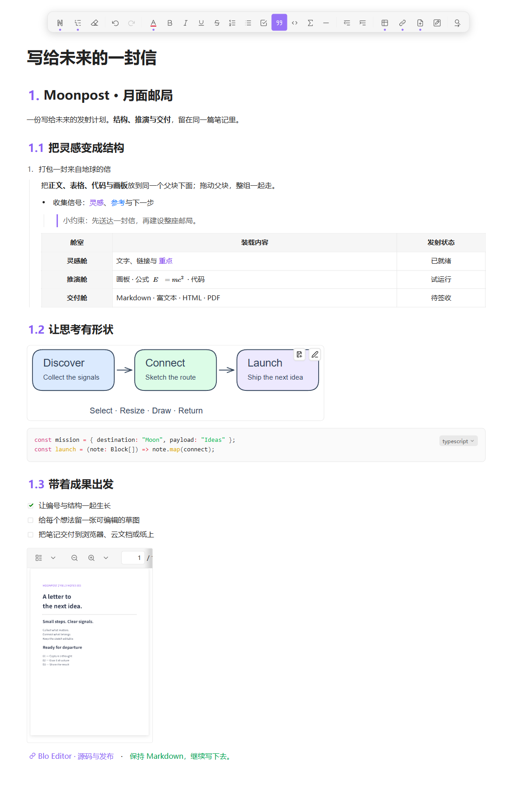
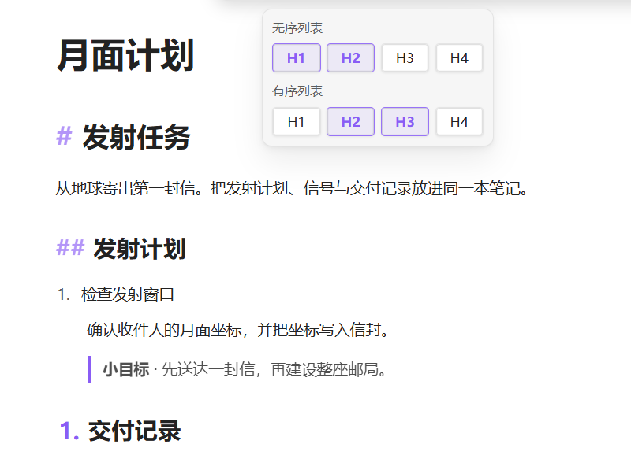
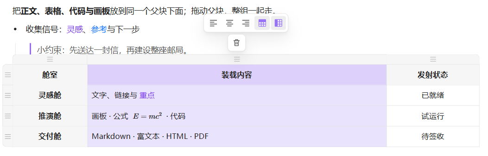
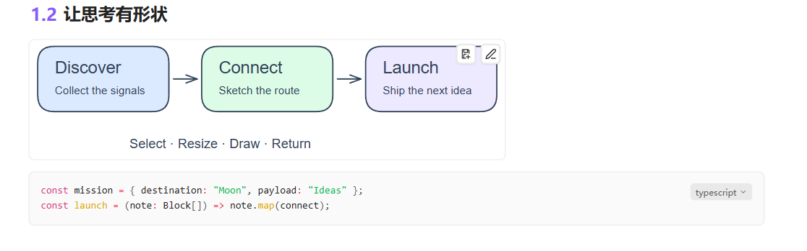
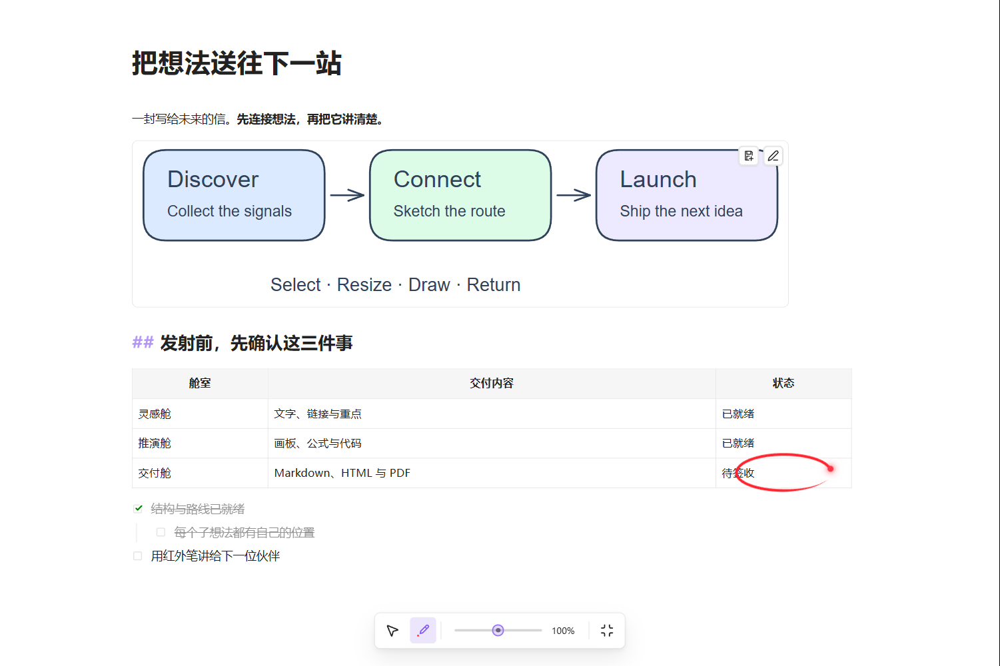
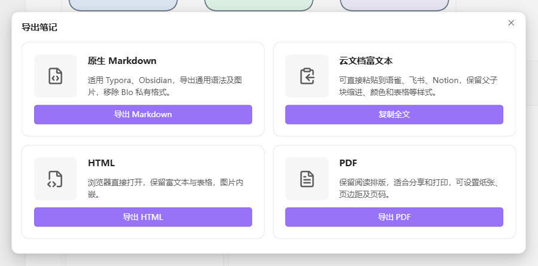

<h1 align="center">Blo Editor</h1>

语雀风格的 Obsidian 块编辑器。 给想法搭起结构，把思考画出来，继续用 Markdown 写下去。

<a href="README.md">English</a> · <strong>简体中文</strong>

演示笔记「**月面邮局**」把一个小项目的计划、草图和交付资料放在一起。截图均来自真实编辑器，使用虚构的公开演示内容。

## 块层级与标题列表

正文、表格、引用、代码和媒体，都能成为同一个父块的子块。拖动父块，整组内容一起移动；用 Tab / Shift+Tab 调整层级，用折叠收起列表子块，层级竖线让关系清晰可见。

H1～H4 可以混用无序和有序列表，并同步到 Obsidian 原生大纲。同级标题混用时，工具栏的两排按钮会同时显示当前样式，点一下即可统一该级格式。

## 表格，也能顺手编辑

按单元格、区域、整行、整列或整表选中。拖选覆盖正文和表格时，选中的表格按整块处理，删除后可以撤销。浮动工具栏可调整对齐和标题行／列，粘贴表格时按需扩展。

## 把笔记上下文交给 AI

选中文字后，右键「复制为 AI 引用」，或使用可自定义的 Ctrl+Shift+C（macOS 为 ⌘⇧C）。复制内容包含精简 Markdown、笔记的本机路径和引用位置，可粘贴到任意 AI 客户端。「设置 → Blo Editor → AI 协作」还提供笔记 Skill 和目录规则，供具备文件访问能力的 AI 使用。

## 文字、草图与资料，留在一起

内嵌可编辑的 **Excalidraw 画板**：调整预览大小，进入画板继续绘制，再返回原笔记。搭配代码高亮、LaTeX 公式、颜色、高亮和任务清单，表达不同类型的思考。

图片和 PDF 支持缩放预览，PDF 保留工具栏与翻页功能。媒体链接可下载到附件目录，以独立块嵌入；原生 Obsidian 块链接则把不同笔记里的具体想法连接起来。

任务清单也有层级竖线。完成父任务，子项一起淡化并加上删除线；取消后恢复，保留各子任务自己的勾选状态。

## 把笔记变成讲解现场

**演示模式**全屏居中展示笔记，支持整体内容缩放。用红外笔划出重点，轨迹随页面滚动，并在松手后逐渐消失。

## 写好之后，带到别处

导出 **Markdown**、复制**云文档富文本**，或保存为 **HTML、PDF**。HTML 与 PDF 尽量保留画板、公式、代码高亮和层级竖线；Markdown 与云文档优先兼容性，不支持通用内嵌的 PDF、画板附件以链接呈现。嵌入的 PDF 在 HTML／PDF 导出中呈现为静态页面预览。

还包括 `/` 命令、查找替换、自动保存、阅读模式，以及可选的浮动速记集成。

## 开始使用

1. 从 [Releases](https://github.com/OrlandoHsu29/obsidian-blo-editor/releases) 下载 ZIP，将 `blo-editor/` 解压到笔记库的 `.obsidian/plugins/`。
2. 重启 Obsidian，在第三方插件中启用 **Blo Editor**。升级时保留原有 `data.json`。
3. 将[演示笔记](examples/feature-tour.md)、[画板](examples/feature-tour.excalidraw.md)和 [PDF](examples/feature-tour.pdf) 放入笔记库的同一文件夹，用 Blo Editor 打开笔记。

需要**桌面版 Obsidian 1.8.7+**。画板预览与编辑依赖 Excalidraw，可通过 Blo 设置中的画板集成安装并启用。其他可选集成包括 Image Toolkit 和 [Glimmer Memo](https://github.com/OrlandoHsu29/obsidian-glimmer-memo)。

笔记保存为 Markdown，Blo 特有的结构通过扩展元数据保留。编辑器基于 **Slate + React**，依赖原生 CodeMirror 的编辑插件不会自动适用于 Blo 视图。云文档粘贴后能保留的格式，以目标应用支持为准。

## 开发与致谢

建议使用 Node.js 22，依次执行 `npm ci`、`npm run typecheck`、`npm run package`。详见 [CONTRIBUTING.md](CONTRIBUTING.md)。

Blo 取自 _block_。由 **OrlandoHsu29** 维护，基于 **Takeshi Morita** 的 [Wysimark Editor](https://github.com/takeshy/obsidian-wysimark) 开发，保留上游版权与 MIT 协议。参见 [LICENSE](LICENSE) 和 [UPSTREAM.json](UPSTREAM.json)。
